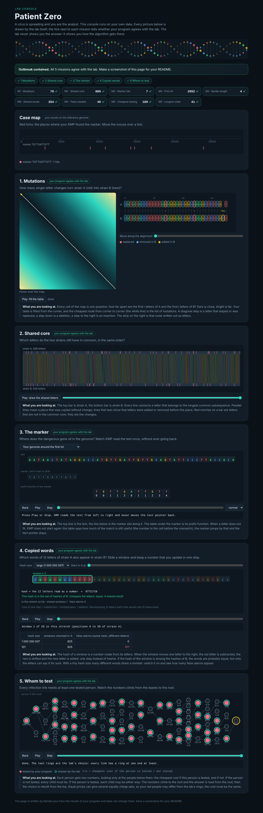

# Assignment 4. Patient Zero

Student ID: 250629
Name: Islam
Group: Brimbayev

This file is the report. Fill it in as you go. How to start: `START_HERE.md`. The task: `docs/Assignment4.pdf`.

## Program output

The 9 lines your program prints on your data (`java -cp out Main`):

    Mutations: 70
    Shared core: 886
    Marker hits: 7
    First hit: 2952
    Border length: 4
    Shared words: 354
    Tests needed: 40
    Cheapest testing: 189
    Longest chain: 41

My outbreak report (a screenshot of `output/outbreak.html`):

## Questions

Answer in your own words, two or three sentences each.

Mission 1. What does the cell d[i][j] of your table mean, and how is it computed from other cells?

d[i][j] is the smallest number of changes (replace, insert, delete) that turn the first i letters of A into the first j letters of B. If the last letters A[i-1] and B[j-1] are equal, I take d[i-1][j-1], otherwise d[i-1][j-1] + 1 (replace). I also try d[i-1][j] + 1 (delete) and d[i][j-1] + 1 (insert) and take the minimum of the three. The first row is 0, 1, 2, ... and the first column is 0, 1, 2, ..., because turning a word into an empty word, or the reverse, costs its length.

Mission 2. How is the longest common subsequence different from the longest common substring? My Shared core is bigger than the number of letters that are the same at the same place: why?

A substring must be one piece without gaps, a subsequence may skip letters, it only keeps the order. In the LCS table, if the letters are equal I take d[i-1][j-1] + 1, otherwise the bigger of d[i-1][j] and d[i][j-1]. My Shared core (886) is bigger than the number of equal letters at the same position because after an insertion or a deletion the rest of the strain is shifted, so many letters still match in order but not at the same place.

Mission 3. What does the prefix function tell you, and why does the pointer in the text never go back in KMP? What is the Border length of my marker and what does it mean?

pi[i] is the length of the longest proper prefix of the marker that is also a suffix of its first i+1 letters. When there is a mismatch, I already know that the last k text letters equal the first k marker letters, so I only move the marker pointer k back to pi[k-1] and keep the text pointer where it is, because those letters are already known to match. My marker is TGTTGATTGTT and its Border length is 4: the beginning TGTT is also the ending, so after a full match the next occurrence can overlap the last one by 4 letters.

Mission 4. Why must you compare the letters after the hashes are equal? What happens to the cost of Rabin-Karp if many windows have the same hash?

Different words can have the same hash (a collision), because there are only MOD possible values, so equal hashes do not prove equal words. In the lab, with hash size 101 there were 571 false alarms, with a big modulus there were 0. If many windows have the same hash, every one needs a letter comparison of up to k letters, so the time goes from about O(n + m) toward O(n * k) in the worst case.

Mission 5. What are the two states of a person in your DP, and how do you get the answer for a person from its children? Why does a greedy "test the person with most links first" not always give the cheapest answer?

For every person v I keep in[v], the cheapest cost of the subtree of v when v is tested, and out[v], the cheapest cost when v is not tested. in[v] = cost[v] + the sum over children of min(in[c], out[c]). out[v] = the sum over children of in[c], because if v is not tested every child must be tested. The answer is min(in[0], out[0]), and I walk down from the root to see who is tested. Greedy can fail because it ignores the costs and the global structure: a person with many links may be very expensive, and testing his cheap neighbours can cover the same links for less.

## AI use

Claude for understanding

## Timing (Mission 7)

Milliseconds, average of 3 runs, from `java -cp out Bench`.

| test | size | time |
|---|---|---|
| naive search | 20 000 / 40 000 / 80 000 | 32.7 / 31.0 / 67.1 |
| KMP | 20 000 / 40 000 / 80 000 | 2.1 / 1.5 / 0.5 |
| edit distance | 500 / 1000 / 2000 / 4000 | 5.9 / 9.7 / 25.2 / 96.3 |

What do the numbers say about how the time grows? When you double the size, by how much does each time grow? Two or three sentences.

The naive search is slow on this worst case, about n times m steps, and its time grew about 2 times when the text doubled (it is noisy at small sizes) while KMP stayed at a few milliseconds because it reads the text once, in linear time. The edit distance grows about 4 times when the length doubles (25.2 to 96.3 ms from 2000 to 4000), which fits O(n * m) with n = m.

## Complexity

n is the length of the text (or of a strain), m the length of the pattern, k the length of the window, v the number of people. Fill in every algorithm you wrote.

| algorithm | time | space | assumptions |
|---|---|---|---|
| Edit distance | O(n * m) | O(n * m) | n and m are the lengths of A and B; table of (n+1) x (m+1) cells, each in O(1) |
| LCS | O(n * m) | O(n * m) | same table size as edit distance, each cell in O(1) |
| Prefix function and KMP | O(m + n) | O(m) | the pointer in the text never goes back, and the pointer in the pattern goes back at most as many times as it went forward (amortized) |
| Rabin-Karp (shared words) | O(n + m) on average, O(n * k) worst case | O(m) | hash of every window updated in O(1), HashMap lookup in O(1) on average; a comparison of k letters only when the hashes are equal |
| Tree DP | O(v) | O(v) | every person and every link is visited once; arrays in[], out[], parent[] of size v |

## Before you submit

- The four files in `data` and the screenshot `output/outbreak.png` are in the repository.
- `java tools/Check.java` shows all examples right.
- This README is filled in, the program output and the section AI use included.
- The work is pushed to main (at least one commit per mission) and the repository is public.
- The link is attached in Moodle.
